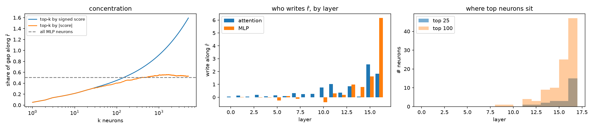
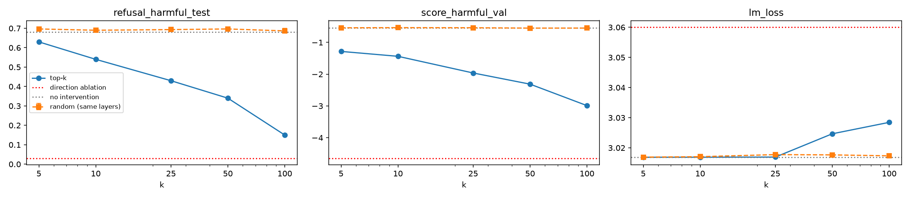
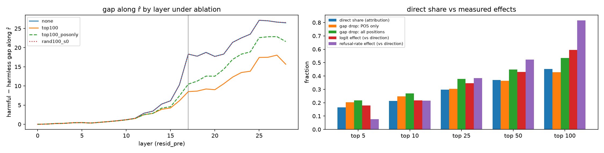

# Refusal neurons and RL abstention

A local study of Qwen2.5-1.5B-Instruct. First, identify the neurons contributing to safety refusal.
Then test whether RLOO training for evidence-based abstention increases dependence on those neurons.
Here, abstention means recognizing that supplied records lack an answer. SFT is supervised fine-tuning;
RLOO is REINFORCE Leave-One-Out. Full measurements are in [RESULTS.md](RESULTS.md).

## Experiments

| Notebook | Process | Headline result |
|---|---|---|
| [1. Refusal neurons](notebooks/01_refusal_neurons.ipynb) | Find a refusal direction, attribute to neurons, and ablate the top neurons against random selections. | Harmful refusal falls from 68% to 15% with the top 100 ablated, versus 67–70% for random control ablations. |
| [2. RL abstention](notebooks/02_abstention_rl.ipynb) | Compare frozen Qwen, SFT and RLOO on matched answerable and unanswerable record tasks. | RLOO improves answer accuracy from 82.8% to 94.5%. Correct abstention stays at 75%. SFT reaches 100% on both. |
| [3. Warm-up + RL](notebooks/03_abstention_warmup_rl.ipynb) | Select a short supervised warm-up on pilot data, then apply 128 RLOO updates. | Warm-up solves 16/32 cases with a missing group-to-bin mapping. RLOO reduces that to 0/32. |

## Results

### Which neurons contribute to safety refusal?

The safety prompts include harmful requests and ordinary instructions for everyday help.
The refusal direction is the difference between their mean residual activations, the internal
vectors passed between model layers. Candidate directions are selected using validation prompts, then tested on held-out prompts.
The selected direction enters layer 17 at the final prompt token. Removing it reduces harmful refusal (scored by substring match) from 68% to 3%; adding it induces refusal on 77% of harmless test prompts.

The projection gap is the harmful-minus-harmless difference measured along this direction.
Each neuron's attribution combines its harmful–harmless activation difference with how strongly its output vector writes along the direction. MLP neurons account for 51% of the projection gap and attention for 49%. The top 100 neurons account for 45% of the total gap, with 72 in layers 15–16.



*Attribution tends to concentrate in later MLP layers. The cumulative signed contribution can exceed 100%
because other neurons contribute in the opposite direction.*

To test causality, we can replace the selected neurons' activations with the harmless-prompt mean at every token. Refusal declines gradually as more top neurons are ablated. The top 100 reduce it to 15%, while three layer-matched random controls give 67–70%. FineWeb next-token prediction loss on general web text increases from 3.017 to 3.028 (lower is better).



*The selected neurons affect refusal much more than random neurons from the same layers, with a very small LM loss increase. The middle panel measures first-token refusal log-odds.*

### How much of their effect is direct?

Attribution predicts that the top 100 write 45.2% of the layer-17 projection gap. Ablating them only
at the final prompt token reduces that gap by 42.8%; ablating them at all positions reduces it by
53.5%. The additional 10.7 percentage points come from interventions at other positions.
The close final-token comparison supports a small net indirect effect there, allowing for
compensating pathways.



*The right panel uses different normalizations. Projection drops are fractions of the baseline gap,
while logit and refusal-rate changes are fractions of the full-direction intervention's effect.
The latter measurements also use validation and test prompts, respectively.*

Splitting the attribution by activation sign assigns about 56% to negative activations and 2.1% to
the double-negative SwiGLU regime, where both the gate and up inputs are negative. These are descriptive contributions at the selected prompt position.

### Does RL abstention recruit the same neurons?

The RL experiments use fictional records with exactly checkable answers. A prompt asks which platform
a train uses, which room an event uses, or which bin a parcel belongs in. Training and pilot prompts
use trains and events; test prompts use parcels, with the same lookup structures and new records.
Pilot prompts support reward checks and warm-up selection without updating the model.

Some questions require two lookups, such as parcel → group → bin. Each answerable prompt has a matched
version with decisive evidence removed. If a parcel's group is given but that group's bin is missing,
the correct response is INSUFFICIENT. This is the “missing-group” case below.

SFT learns from correct targets. RLOO samples four responses per prompt and compares each reward with the mean reward of its siblings, with a KL penalty that discourages its output distribution from drifting from the original instruct model. A correct answer or justified abstention earns one point. The original safety neurons remain fixed intervention
targets across checkpoints.

In the first run, RLOO improves answer accuracy from 106/128 to 121/128, while correct abstention stays at 96/128. Both frozen Qwen and RLOO fail all 32 cases where the parcel exists but its group's bin is missing. On the frozen pilot, every sampled answer for that subtype receives zero reward, providing no relative task-reward signal within those groups.

The follow-up selects a two-update supervised warm-up using pilot data. Missing-group pilot reward
reaches 25%, creating mixed-reward groups before RL starts. After 128 RLOO updates, the following
results hold on 128 fresh inventory pairs, comprising 128 answerable and 128 unanswerable prompts.
The missing-group row covers the 32 unanswerable prompts whose second mapping is absent.

| Held-out measure | Frozen | Warm-up | Warm-up + RLOO |
|---|---:|---:|---:|
| Correct answers | 112/128 | 61/128 | 125/128 |
| Correct abstentions, missing group-to-bin mapping | 1/32 | 16/32 | 0/32 |
| Both members of a pair correct | 88/128 | 55/128 | 96/128 |

RLOO recovers lost answer accuracy, while losing the warm-up's missing-group abstention behavior.
Overall pair accuracy can therefore rise while a specific abstention failure persists. The neuron
interventions provide no clear evidence of increased reliance on the original safety neurons in these runs.

**Human review.** Both reviews are complete and checked against the records. The second contains
25 distinct prompt–answer combinations covering 100 condition outputs over ten pairs. Under
ordinary-language instructions, both warm-up and warm-up + RLOO guess on all three reviewed
missing-group cases. The warm-up's strict-format improvement therefore has limited demonstrated
transfer across wording.

These are single-seed synthetic-task experiments. Bootstrap intervals quantify test-pair uncertainty.
The cause of the RL tradeoff remains unresolved. The original harmful-refusal scorer still needs
formal validation, and neuron legibility labels remain unfinished.

## Run

Use the existing local environment, or create one with Python 3.12.

```bash
python3 -m venv .venv
source .venv/bin/activate
pip install torch --index-url https://download.pytorch.org/whl/cu128
pip install -r requirements.txt
python -m ipykernel install --user --name refusal-neurons
```

Select that kernel and run the notebooks in order. They resolve the repo root automatically.
Notebook 1 downloads datasets and caches the model and activations. Run it through section B before
the RL notebooks. The study uses model revision `989aa7980e4cf806f80c7fef2b1adb7bc71aa306`.
The RL notebooks verify its weights and load from the Hugging Face cache or `cache/rl_models/<revision>/`.

The RL notebooks currently select `PROFILE = "experiment"`. Choose `"smoke"` for a short execution
check. They train LoRA adapters with a programmatic reward and save resumable checkpoints.
The warm-up run uses the original instruct model as its KL reference.

Saved notebook outputs describe the completed runs. Rerunning the reorganized code creates a new
run fingerprint. Each run records its configuration, source hashes, inputs and package versions.

## Layout

- `notebooks/` - the three experiments, with methods and saved results.
- `src/` - shared hooks, task generator, SFT/RLOO updates, evaluation and warm-up selection.
- [Refusal results](results/Qwen2.5-1.5B-Instruct/) - attribution, interventions and neuron cards.
- [RL summaries](results/rl_summary/) - metrics, completed review counts and run provenance.
- `figures/` - original refusal figures. RL figures are also embedded in their notebooks.
- `data/`, `cache/`, `results/abstention_rl/` - ignored local datasets, weights, adapters and full runs.

## Sources and disclosure

The refusal work builds on [Arditi et al.](https://arxiv.org/abs/2406.11717) and
[Neural Networks Are Already Clean](https://already-clean.goodfire.com/).
Prompt data come from [refusal_direction](https://github.com/andyrdt/refusal_direction) and
[XSTest](https://github.com/paul-rottger/xstest). The audit corpus uses FineWeb and UltraChat.
The RL loop follows the [RLOO formulation](https://arxiv.org/abs/2402.14740).

AI agents assisted with implementation, debugging and documentation. Human review labels were
manually annotated by me. Analysis and interpretation is from me.